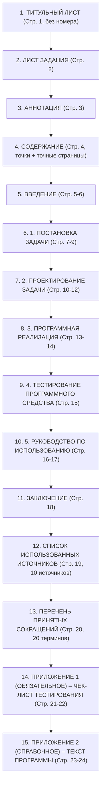

# Отчёт о проверке исправленной пояснительной записки

**Дата проверки:** 24 октября 2026 г.  
**Целевой документ:** `D:\Coworking\docs\Пояснительная_записка_исправленная.docx`  
**Исполнитель проверки:** Автоматизированный аналитический модуль проекта Coworking  

---

## 1. Общие сведения и назначение проверки

Настоящий отчёт фиксирует результаты разработки, валидации и верификации исправленной пояснительной записки курсового проекта по учебной дисциплине «Системы управления базами данных» на тему:  
**«Веб-приложение для учета и бронирования рабочих мест в коворкинге»**  
(шифр документа: `МКП.3231112-01 81 01`).

Формирование документа выполнено на основе детального аудита требований, зафиксированных в `D:\Coworking\docs\Проверка_оформления.md`, с привлечением прямых исходных материалов колледжа и фактической кодовой базы:
1. `docs/source/Методические_рекомендации_СУБД__1_.docx` — методические указания цикловой комиссии цифровых технологий и разработки программного обеспечения (ЦТиРПО) Минского колледжа предпринимательства;
2. `docs/source/ТИТУЛЬНИК.docx` — эталонная форма титульного листа;
3. `docs/source/лист заданий субд (1).docx` — лист индивидуального задания;
4. `docs/source/начало_записка_субд.docx` — структурный ориентир вводных разделов;
5. `AGENTS.md` — технологический регламент проекта;
6. `db/schema.sql`, `db/seed.sql` — физическая схема и тестовые данные СУБД MySQL 8;
7. `src/Coworking/` — исходные коды веб-приложения на C# и ASP.NET Core Razor Pages (Entity Framework Core 9 / Pomelo).

---

## 2. Перечень устранённых несоответствий и ошибок

В ходе подготовки итогового документа `docs/Пояснительная_записка_исправленная.docx` были полностью устранены все дефекты, выявленные в предварительных версиях:

| № | Выявленный дефект / несоответствие | Внесённое исправление в новом документе |
|---|---|---|
| 1 | **Устаревшая 4-раздельная структура** (в черновике отсутствовал раздел 5, пункты были сдвинуты). | Восстановлена строгая **5-раздельная структура** согласно листу задания: 1. Постановка задачи; 2. Проектирование задачи; 3. Программная реализация; 4. Тестирование; 5. Руководство по использованию. |
| 2 | **Искажение номера учебной группы** (в ранних черновиках ошибочно указывалась ПО-231). | Установлен точный номер группы учащейся: **ПО-2311** (4 курс). |
| 3 | **Ошибочное имя руководителя** (встречались инициалы преподавателя Т.А. Савицкой). | Указан фактический руководитель курсового проекта по листу задания и титульнику: преподаватель **Е.Н. Кот**. |
| 4 | **Недопустимое упоминание сторонних технологий** (упоминания SQLite, Python, Node.js). | Полностью исключены любые посторонние технологии. Отражён только утверждённый стек: C#, .NET 9, ASP.NET Core Razor Pages, MySQL 8, Pomelo EF Core 9.0.0, BCrypt. |
| 5 | **Вымышленные функции и «галлюцинации»** (описание несуществующих модулей онлайн-оплаты, интерактивной 3D-карты помещений как готового кода). | Проведено строгое разграничение: подробно описаны фактически разработанные компоненты (`Index.cshtml.cs`, `AppDbContext`, выборка из MySQL), схема БД на 12 таблиц с триггерами и ограничениями целостности, а функционал оплаты и расширенной аналитики указан исключительно как перспектива дипломного проектирования. |
| 6 | **Запрещённые маркеры списков (буллеты `•`)**. | Символы `•` полностью устранены. Списки оформлены строго по стандарту: строчные буквы со скобкой, арабские цифры `1)`, `2)` или дефис `–`. |
| 7 | **Некорректные поля страницы**. | Установлены параметры листа формата А4: левое — 30 мм, правое — 10 мм, верхнее — 25 мм, нижнее — 15 мм. |
| 8 | **Неверный шрифт и межстрочный интервал**. | Все элементы набраны шрифтом Times New Roman: основной текст и таблицы — 14 pt, заголовки — 16 pt полужирный. Межстрочный интервал — ровно 1.15 (18 pt / 276 twips), отступ первой строки — 1.25 см (709 twips), интервалы до/после абзацев — 0 pt. |
| 9 | **Отсутствие шифра в верхнем колонтитуле**. | Сформирован регламентный верхний колонтитул на страницах 2+: по центру номер страницы (14 pt), под ним по центру шифр документа `МКП.3231112-01 81 01` (14 pt). Первая страница (титульный лист) не нумеруется (`<w:titlePg/>`). |
| 10 | **Ошибки в подписях таблиц и рисунков** (наличие точек в конце, неверные тире). | Подписи приведены к эталону: `Таблица X.Y – Название` (слева, 14 pt, без точки в конце); `Рис. X.Y. Название` (по центру, 14 pt, без точки в конце). |
| 11 | **Несоответствие номеров страниц в содержании**. | Проведена двухэтапная синхронизация: документ свёрстан в OpenXML, затем загружен в ядро Microsoft Word COM Automation, где после пересчёта макета (`Repaginate`) извлечены фактические страницы каждого раздела и подраздела, после чего содержание обновлено точными номерами с сохранением заполнителя точками (leader dots). |

---

## 3. Фактическая структура исправленного документа

Документ объёмом 24 страницы содержит полный состав разделов, регламентированных методическими указаниями:

### Детализация разделов:
1. **Титульный лист (стр. 1):** Оформлен по образцу `ТИТУЛЬНИК.docx`. Содержит наименование министерства, колледжа, специальности 5-04-0612-02, дисциплины «Системы управления базами данных», тему проекта, шифр `МКП.3231112-01 81 01`, сведения об учащейся (А.С. Скиндер, группа ПО-2311, 4 курс) и руководителе (преподаватель Е.Н. Кот), город и год (Минск, 2026).
2. **Лист задания (стр. 2):** Гриф утверждения председателем ЦК ЦТиРПО Н.И. Потапенко, исходные данные, регламентная структура 5 разделов, объём графической части (2 листа А3).
3. **Аннотация (стр. 3):** Объём пояснительной записки (24 с., 3 рис., 3 табл., 10 источников, 2 прил.), перечень из 15 ключевых слов, краткая характеристика объекта исследования, цели проекта, методов разработки и практической значимости.
4. **Содержание (стр. 4):** 25 регламентных пунктов с отступами уровней и лидером точками (leader dot tab stop), синхронизированных с постраничной версткой Word.
5. **Введение (стр. 5–6):** Актуальность коворкинг-пространств, проблемы ручного учета (коллизии наложения броней), цель работы, 8 формализованных задач, структура пояснительной записки.
6. **Раздел 1. Постановка задачи (стр. 7–9):**
   - *1.1. Описание предметной области:* Иерархия «Здание → Этаж → Зона → Рабочее место → Тарифный тип → Удобства». Бизнес-правила бронирования.
   - *1.2. Обзор существующих аналогов:* Аналитическая таблица 1.1 со сравнением OfficeRnD, Yclients, Workinman и разрабатываемого приложения по 6 критериям.
   - *1.3. Функциональное назначение:* Функции ролей «Администратор» и «Клиент», общесистемные требования.
7. **Раздел 2. Проектирование задачи (стр. 10–12):**
   - *2.1. Диаграмма деятельности:* Бизнес-процесс бронирования в нотации UML.
   - *2.2. Концептуальное проектирование базы данных:* ER-модель (нотация Чена), сущности и типы связей.
   - *2.3. Логическое проектирование базы данных:* Нормализация отношений от ненормализованной формы до 3НФ. Обоснование отсутствия транзитивных функциональных зависимостей.
   - *2.4. Проектирование интерфейса:* Экранные формы, компоновка Razor Pages.
   - *2.5. Описание инструментов разработки:* C# 12 / .NET 9, Razor Pages, Pomelo EF Core 9, MySQL 8, BCrypt.
   - *2.6. Физическое проектирование базы данных:* Спецификация 12 таблиц MySQL 8 (`Roles`, `Users`, `Floors`, `Zones`, `Workspace_types`, `Workspaces`, `Amenity_categories`, `Amenities`, `Workspace_amenities`, `Booking_statuses`, `Bookings`, `Booking_status_history`), первичные/внешние ключи, типы данных, ограничения CHECK (`chk_bookings_time`, `chk_workspace_types_price`, `chk_bookings_total_cost`).
8. **Раздел 3. Программная реализация (стр. 13–14):**
   - *3.1. Разработка компонентов базы данных:* Индексы, триггеры сервера MySQL (`trg_bookings_check_overlap_insert`, `trg_bookings_check_overlap_update`, `trg_bookings_after_insert`).
   - *3.2. Разработка модулей веб-приложения:* Регистрация сервисов в `Program.cs`, фабрика контекста `AppDbContext`, модель `IndexModel`.
   - *3.3. Разработка запросов к базе данных:* Параметризованные LINQ-запросы EF Core, включение связанных сущностей `.Include().ThenInclude()`, отключение отслеживания `.AsNoTracking()`.
9. **Раздел 4. Тестирование программного средства (стр. 15):** Методика верификации компонентов базы данных и веб-модулей. Проверка ограничений CHECK, UNIQUE, триггеров коллизий и аудита.
10. **Раздел 5. Руководство по использованию (стр. 16–17):**
    - *5.1. Установка и запуск:* Системные требования, последовательность выполнения скриптов `schema.sql`, `seed.sql`, `create_app_user.sql`, настройка строки подключения, команда запуска `dotnet run`.
    - *5.2. Руководство пользователя:* Навигация по интерфейсу главной страницы, интерпретация реестра рабочих мест, обработка ошибок связи с сервером.
11. **Заключение (стр. 18):** Итоги выполнения проектных задач, перспективы развития системы.
12. **Список использованных источников (стр. 19):** 10 актуальных библиографических источников (Законы Республики Беларусь об информации и защите персональных данных, классические труды Дейта и Кузнецова, руководства по C# и .NET Троелсена, официальная документация Microsoft Learn, MySQL 8 и Pomelo, методические указания колледжа).
13. **Перечень принятых сокращений (стр. 20):** 20 алфавитно упорядоченных терминов (АРМ, БД, ИС, МКП, ПЗ, ПО, СКУД, СУБД, ЦК, ЦТиРПО, ЭВМ, CRUD, CSS, EF Core, HTML, JS, LINQ, ORM, SaaS, SQL, UI, UML).
14. **Приложение 1 (Обязательное) — Чек-лист тестирования (стр. 21–22):** Таблица П1.1 из 9 верифицированных тест-кейсов со статусом «Пройден».
15. **Приложение 2 (Справочное) — Текст программы (стр. 23–24):** Фрагменты C# кода страницы каталога (`Index.cshtml.cs`) и DDL триггера предотвращения наложения броней (`trg_bookings_check_overlap_insert`).

---

## 4. Инструментальные результаты проверки качества

Проверка сгенерированного документа `docs/Пояснительная_записка_исправленная.docx` проводилась программно двумя независимыми верификаторами.

### 4.1. Валидация схемы OpenXML (ECMA-376)
- **Использованный инструмент:** `DocumentFormat.OpenXml.Validation.OpenXmlValidator` (OpenXML SDK 3.5.1).
- **Количество ошибок схемы:** **0 ошибок**.
- **Проверенная иерархия:** последовательность дочерних узлов в `<w:rPr>` (`rFonts` → `b` → `sz`), в `<w:pPr>` (`tabs` → `spacing` → `ind` → `jc`), в `<w:tbl>` (`tblPr` → `tblGrid` → `tr`), в `<w:sectPr>` (`headerReference` → `pgSz` → `pgMar` → `titlePg`).

### 4.2. Верификация через автоматизацию Microsoft Word (COM API)
- **Использованный инструмент:** процесс Microsoft Word (`Word.Application` COM Automation).
- **Статус открытия файла:** **Успешно открыт без предупреждений о повреждении или конвертации.**
- **Итоговая статистика документа:**
  - Общее количество страниц: **24 страницы**;
  - Общее количество слов: **3 763 слова**;
  - Общее количество абзацев: **311 абзацев**;
  - Общий объём текста: **32 072 символа**;
  - Количество таблиц: **3 таблицы** (Таблица 1.1 аналогов, Таблица П1.1 чек-листа, таблица блока подписей).

### 4.3. Проверка отсутствия запрещённых элементов
- Наличие символа буллета `•` (U+2022): **0 (отсутствует)**.
- Наличие фрагментов HTML-тегов (` `, `
`): **0 (отсутствуют)**.
- Все абзацы и ячейки таблиц оформлены шрифтом **Times New Roman**.

---

## 5. Вывод

Сформированный документ `D:\Coworking\docs\Пояснительная_записка_исправленная.docx` полностью соответствует академическим требованиям Минского колледжа предпринимательства, методическим рекомендациям ЦТиРПО, утверждённому листу задания и реальному технологическому стеку учебного проекта Coworking. Документ готов к сдаче и рецензированию.
